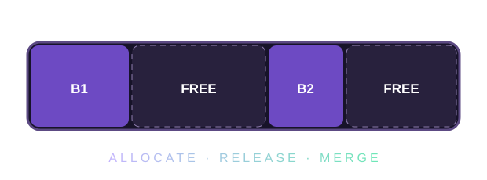

<p align="center">
  
  <br/>
  <br/>   
  <br/>
</p>

## 🧭 Overview

Memory Fragmentation Lab is a local operating-systems playground for contiguous allocation. Allocate and free blocks while comparing first-fit, best-fit, and worst-fit placement.

## ✨ Features

- 🧱 Visualize allocated blocks and free holes across a fixed memory space.
- 🎯 Switch between first-fit, best-fit, and worst-fit selection.
- 📊 Track free memory, largest hole, and an external-fragmentation estimate.
- ♻️ Free allocations and merge neighboring holes.
- 🔒 No uploads, accounts, or external libraries.

## 🎬 Demo

Start the app, choose an allocation strategy, enter a request size, and allocate or free blocks. The memory map and metrics update immediately; no hosted demo is claimed.

## 🚀 Quick Start

Requires Node.js 18 or newer.

```bash
npm start
```

Open http://localhost:4173.

## 🧰 Tech Stack

- 🟢 Node.js built-in HTTP server
- 🌐 HTML, CSS, browser JavaScript, and CSS Flexbox
- 📦 No third-party runtime dependencies

## 🗂️ Folder Structure

```text
memory-fragmentation-lab/
├── assets/mark.svg
├── app.js
├── index.html
├── server.js
├── package.json
├── README.md
├── LICENSE
└── .gitignore
```

## 🛣️ Roadmap

- [ ] Add paging and segmentation modes.
- [ ] Visualize compaction as a separate operation.
- [ ] Export allocation traces.

## 🤝 Contributing

Open issues for incorrect allocation behavior or accessibility improvements. Keep the simulator deterministic and document any new policy.

## 📄 License

MIT licensed. See [LICENSE](LICENSE).

<p align="center"></p>
